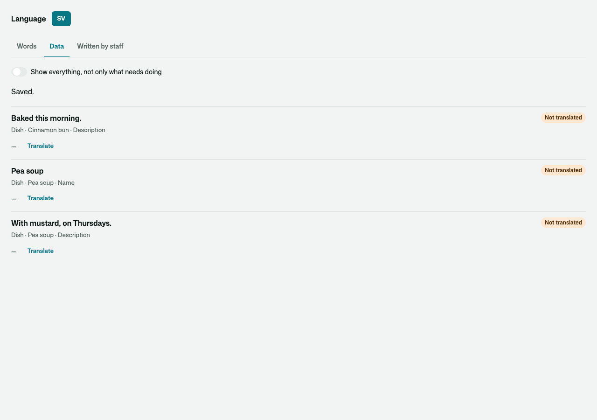
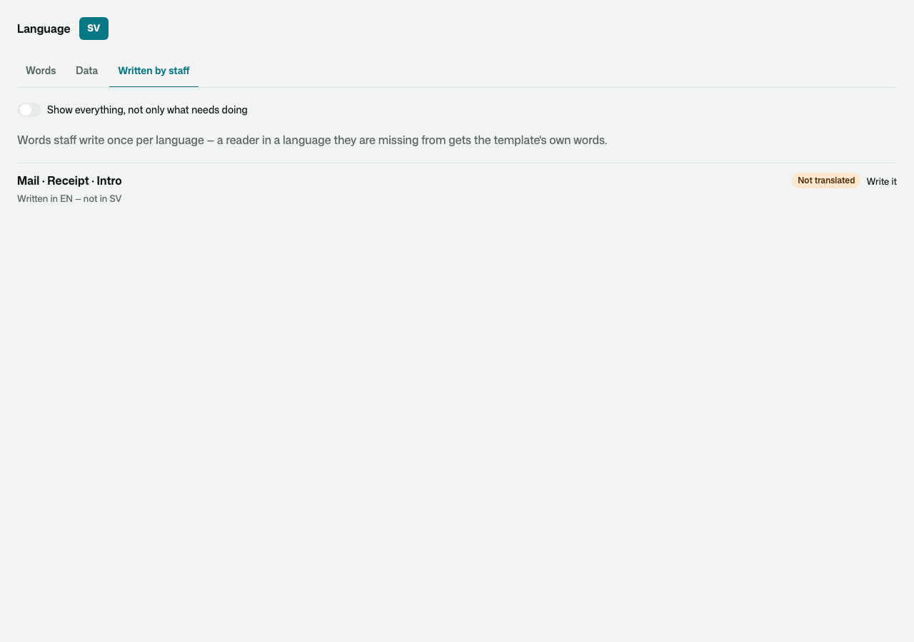
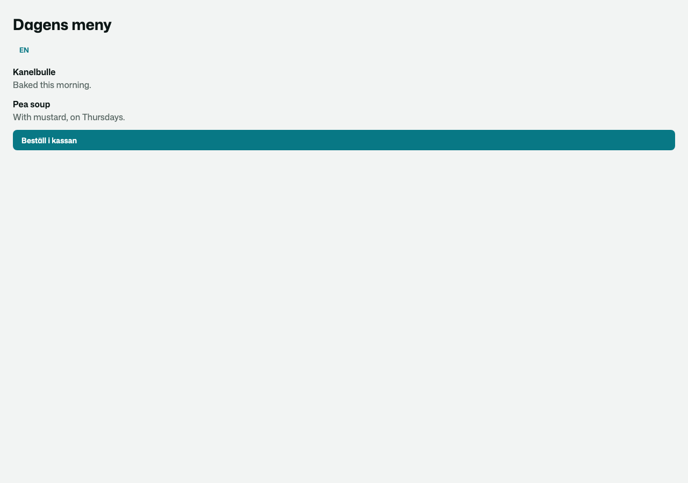

# Osysharp.Localization — a translator's desk for an app that speaks more than one language

## Use case

An app ships its words in `locales/<language>.osy` files, and its data — a product's name, a dish's description — in
`[Translatable]` fields. Both change after launch: a button gets new words, a product is added in the source
language only, and somebody has to notice what is now missing or out of date in Swedish. This kit is the page where
staff do that, without a recompile or a deploy:

- **Words** — every text the app shows, with where it is and what sits beside it, and what is not translated yet or
  went stale because its source changed. A word changed here is an override kept as data, so the next compile does not
  undo it.
- **Data** — every `[Translatable]` value of every row, missing or stale in the language.
- **Written by staff** — words staff write once per language somewhere else in the app (a mail's paragraph), written in
  some languages and not in others.





What a Swedish reader then sees — the locale file's words, the desk's override and the translated dish, together:



## Install and use

```osy
app Cafe {
  use Osysharp.Ui;
  use Osysharp.Localization@0;
  …
}
```

Say who may translate, with your own roles — until you do, nobody can:

```osy
policy EditsTranslations => IsStaff;
```

Put the desk on a staff page:

```osy
using Osysharp.Localization;

[Route("/staff/translations")] [Authorize(IsStaff)]
component StaffTranslations() { render { TranslationsDesk(); } }
```

If staff write words per language elsewhere in the app, list those places so the desk can show what is missing:

```osy
app.Translations = new TranslationsSetup { Written = [ new MyMailWords() ] };   // each an IWrittenWords
```

## Source and package

- Source: `model/Translations.osy` (the overrides, the lists the desk reads, `TranslationsSetup`) and
  `model/ui/Desk.osy` (`TranslationsDesk`).
- Tests: `tests/` — a small café app in English and Swedish; `translations-ui.test.osy` drives the desk in a browser.
- Package: `use Osysharp.Localization@0;` — `osy lock` fetches the release archive from this repository's releases.

Fork it to build your own desk: copy the folder into your app's `kits/`, keep the package name or change it, and your
app resolves it from there.
